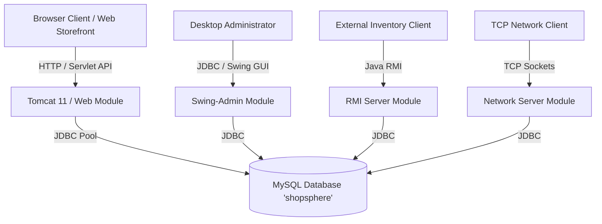

# Advanced Java Programming Laboratory & ShopSphere Enterprise System

[](https://www.oracle.com/java/)
[](https://jakarta.ee/)
[](https://www.mysql.com/)
[](https://maven.apache.org/)
[](https://tomcat.apache.org/)
[](#)

A centralized repository containing all **Advanced Java Lab Experiments (Experiments 1 to 6)** along with the complete **ShopSphere Enterprise E-Commerce Capstone Project**, structured strictly according to academic and professional submission guidelines.

---

## 👤 Author & Submission Information
* **Student Name:** Khushi khandelwal
* **GitHub Profile:** [khushi-khandelwal27](https://github.com/khushi-khandelwal27/java-experiments)
* **Repository URL:** [https://github.com/khushi-khandelwal27/java-experiments.git](https://github.com/khushi-khandelwal27/java-experiments.git)
* **Subject:** Advanced Java Programming Lab & Final Project Submission

---

## 📂 Repository Structure

```text
Java-Experiments/
├── .gitignore                                      # Ignore compiled class files, target/ & IDE cache
├── README.md                                       # Master repository documentation
│
├── Experiment-01-Student-Registration/             # Exp 1: Java Swing GUI with MySQL Integration
│   ├── lib/mysql-connector-j-26.7.0.jar            # MySQL JDBC Type-4 Driver
│   ├── schema.sql                                  # Database schema for student records
│   └── src/
│       ├── DatabaseConnection.java                 # JDBC connection management
│       └── StudentRegistration.java                # Swing GUI with Form Validation & CRUD
│
├── Experiment-02-MVC-Calculator/                   # Exp 2: Model-View-Controller Architecture
│   ├── modelscalculator.java                       # Model: Business logic & arithmetic state
│   ├── viewscalculator.java                        # View: Swing GUI presentation layer
│   ├── controllercalculator.java                   # Controller: ActionListeners & event mediator
│   └── runcalculator.java                          # Main entry point bootstrap
│
├── Experiment-03-JDBC-Operations/                  # Exp 3: JDBC Database Operations
│   ├── lib/mysql-connector-j-26.7.0.jar            # MySQL JDBC Type-4 Driver
│   ├── setup.sql                                   # College database table setup script
│   └── src/
│       └── JdbcDemo.java                           # PreparedStatements, INSERT & SELECT queries
│
├── Experiment-04-Socket-Programming/               # Exp 4: TCP Client-Server Communication
│   ├── server.java                                 # Multithreaded TCP ServerSocket implementation
│   └── client.java                                 # Client Socket connecting over TCP/IP
│
├── Experiment-05-RMI-Calculator/                   # Exp 5: Remote Method Invocation (Distributed)
│   ├── calcinterface.java                          # Remote Interface extending java.rmi.Remote
│   ├── calcimpli.java                              # Remote Object implementing UnicastRemoteObject
│   ├── server.java                                 # RMI Registry binder & server host
│   └── client.java                                 # RMI Client performing remote procedure calls
│
├── Experiment-06-Servlets-and-Filters/             # Exp 6: Jakarta Servlets, Filters & Listeners
│   ├── pom.xml                                     # Maven dependency & WAR packaging configuration
│   └── src/main/
│       ├── java/com/servlet/
│       │   ├── HelloServlet.java                   # Basic HTTP GET servlet
│       │   ├── LoginServlet.java                   # Authentication servlet handling POST
│       │   ├── HomeServlet.java                    # Session-aware dashboard servlet
│       │   ├── StudentServlet.java                 # Student records dispatcher
│       │   ├── AuthFilter.java                     # Request filter for authentication control
│       │   └── AppListener.java                    # ServletContextListener lifecycle observer
│       └── webapp/
│           └── index.html                          # Web client landing page
│
└── ShopSphere/                                     # Complete Java Enterprise Capstone Project
    ├── pom.xml                                     # Parent aggregator POM (Multi-module build)
    ├── database/
    │   └── shopsphere.sql                          # Complete relational schema with seed data
    ├── docs/
    │   └── Java_Advanced_ShopSphere_Project_Guide.docx # Detailed project guide & documentation
    ├── scripts/                                    # Automated Windows runner batch scripts
    │   ├── setup-database.bat                      # One-click MySQL database installer
    │   ├── deploy-tomcat.bat                       # Maven package & auto-deploy to Tomcat 11
    │   ├── run-swing-admin.bat                     # Launch Desktop Swing Admin application
    │   ├── run-rmi-server.bat                      # Start standalone RMI Inventory Service
    │   ├── run-rmi-client.bat                      # Run interactive RMI test client
    │   ├── run-socket-server.bat                   # Start TCP socket catalog server
    │   └── run-socket-client.bat                   # Connect socket client for real-time queries
    ├── web/                                        # Web Tier: Servlets, JSP 3.1, JSTL, Filters, MVC
    ├── swing-admin/                                # Admin Tier: Desktop Swing GUI with Dashboard & Tables
    ├── rmi/                                        # Distributed Tier: RMI Remote Inventory Service
    └── network/                                    # Network Tier: Multithreaded Socket Catalog Server
```

---

## 🧪 Detailed Lab Experiments Index

### [Experiment 01] Student Registration System (GUI & JDBC)
* **Folder:** [`Experiment-01-Student-Registration`](./Experiment-01-Student-Registration)
* **Objective:** Design a graphical user interface (GUI) using Java Swing to collect student registration details and persist records into a MySQL database via JDBC.
* **Key Topics:** `JFrame`, `JTextField`, `JComboBox`, `JButton`, JDBC `DriverManager`, `PreparedStatement`.
* **Execution:**
  ```bash
  cd "Experiment-01-Student-Registration"
  # 1. Execute schema.sql in MySQL to initialize student_db
  # 2. Compile and run:
  javac -cp ".;lib/mysql-connector-j-26.7.0.jar" src/*.java -d bin
  java -cp "bin;lib/mysql-connector-j-26.7.0.jar" StudentRegistration
  ```

---

### [Experiment 02] MVC Calculator Application
* **Folder:** [`Experiment-02-MVC-Calculator`](./Experiment-02-MVC-Calculator)
* **Objective:** Implement a calculator application utilizing the **Model-View-Controller (MVC)** architectural pattern to ensure loose coupling between presentation, business logic, and user inputs.
* **Key Topics:** Separation of concerns, Event-driven programming (`ActionListener`), State encapsulation.
* **Execution:**
  ```bash
  cd "Experiment-02-MVC-Calculator"
  javac *.java
  java runcalculator
  ```

---

### [Experiment 03] JDBC Database Connectivity & Query Operations
* **Folder:** [`Experiment-03-JDBC-Operations`](./Experiment-03-JDBC-Operations)
* **Objective:** Demonstrate end-to-end database connectivity using JDBC Type-4 driver, executing parameterized SQL statements and processing `ResultSet` outputs.
* **Key Topics:** `Connection`, `PreparedStatement`, SQL injection prevention, `ResultSet` navigation.
* **Execution:**
  ```bash
  cd "Experiment-03-JDBC-Operations"
  # 1. Execute setup.sql in MySQL to create college database
  # 2. Compile and run:
  javac -cp ".;lib/mysql-connector-j-26.7.0.jar" src/JdbcDemo.java -d bin
  java -cp "bin;lib/mysql-connector-j-26.7.0.jar" JdbcDemo
  ```

---

### [Experiment 04] TCP Client-Server Socket Programming
* **Folder:** [`Experiment-04-Socket-Programming`](./Experiment-04-Socket-Programming)
* **Objective:** Build a bidirectional network communication bridge over TCP using `java.net.ServerSocket` and `java.net.Socket`.
* **Key Topics:** Stream I/O (`BufferedReader`, `PrintWriter`), Port binding, TCP Handshake, Client-Server architecture.
* **Execution:**
  ```bash
  cd "Experiment-04-Socket-Programming"
  javac *.java
  # Terminal 1 - Start Server:
  java server
  # Terminal 2 - Start Client:
  java client
  ```

---

### [Experiment 05] Distributed Remote Method Invocation (RMI)
* **Folder:** [`Experiment-05-RMI-Calculator`](./Experiment-05-RMI-Calculator)
* **Objective:** Implement distributed computing where a client invokes methods located on a remote JVM across a network using Java RMI.
* **Key Topics:** `Remote` interface, `UnicastRemoteObject`, `Naming.rebind`, `LocateRegistry`, Remote Procedure Calls.
* **Execution:**
  ```bash
  cd "Experiment-05-RMI-Calculator"
  javac *.java
  # Terminal 1 - Start RMI Registry & Server:
  java server
  # Terminal 2 - Start RMI Client:
  java client
  ```

---

### [Experiment 06] Jakarta Servlets, HTTP Filters & Application Lifecycle
* **Folder:** [`Experiment-06-Servlets-and-Filters`](./Experiment-06-Servlets-and-Filters)
* **Objective:** Develop a modular Java Web Application using the Jakarta Servlet specification, incorporating request lifecycle filters, authentication checks, and session tracking.
* **Key Topics:** `HttpServlet`, `HttpServletRequest`, `HttpServletResponse`, `Filter` chaining, `HttpSession`, `ServletContextListener`.
* **Execution:**
  ```bash
  cd "Experiment-06-Servlets-and-Filters"
  mvn clean package
  # Copy target/demo.war (or servlet.war) to $CATALINA_HOME/webapps/
  ```

---

## 🛒 ShopSphere - Java Enterprise Capstone Project

**ShopSphere** is a complete, enterprise-grade e-commerce application developed as a capstone project for the Advanced Java curriculum. It demonstrates multi-tier enterprise architecture by bridging web interfaces, desktop management tools, and distributed network services.



### Module Breakdown:
1. **`ShopSphere/web` (E-Commerce Web Application):**
   * Built with Jakarta Servlet 6.1, Jakarta JSP 4.0, and JSTL 3.0.
   * Features: Product catalog, categorized browsing, live shopping cart, discount coupon engine, order checkout, PDF invoice generation, user profile management, review system, and administrative control panels.
   * Demonstrates internationalization (i18n in English and Hindi), JNDI resources, and custom JSP tags (`<tags:productCard>`).
2. **`ShopSphere/swing-admin` (Desktop Management Console):**
   * Built with Java Swing (`JFrame`, `JTable`, custom renderers).
   * Allows store managers to manage inventory, update product listings, view sales analytics, and update order fulfillment statuses.
3. **`ShopSphere/rmi` (Distributed Remote Inventory Service):**
   * Implements `InventoryService` as a remote RMI interface.
   * Enables third-party systems or remote warehouses to query real-time stock levels and trigger inventory synchronization without direct database access.
4. **`ShopSphere/network` (Multithreaded Socket Catalog Server):**
   * Custom TCP socket server listening on port `5050`.
   * Accepts text commands (`GET_ALL`, `SEARCH:<term>`, `GET:<id>`, `CHECK_STOCK:<id>`) and responds with serialized JSON/text product models.
5. **`ShopSphere/database` (Relational Schema):**
   * Contains complete DDL & seed data script `shopsphere.sql`.
   * Tables: `users`, `categories`, `products`, `orders`, `order_items`, `addresses`, `payments`, `reviews`, `coupons`, `wishlist`.

---

## 🚀 Quick Start & Execution Guide for ShopSphere

### 1. Prerequisites
* **Java Development Kit (JDK):** Version 17 or higher (`java -version`)
* **Apache Maven:** Version 3.8 or higher (`mvn -version`)
* **MySQL Server:** Version 8.0 or higher
* **Apache Tomcat:** Version 10.1 or 11.0 (for deploying the web application)

### 2. Database Setup
1. Start your MySQL service.
2. Initialize the database using the provided automated script:
   ```cmd
   cd ShopSphere\scripts
   setup-database.bat
   ```
   *(Alternatively, run `mysql -u root -p < ShopSphere/database/shopsphere.sql`)*

### 3. Build Entire Project with Maven
From the `ShopSphere/` root directory:
```bash
cd ShopSphere
mvn clean package
```

### 4. Running the Components

| Component | Automated Script | Manual Command |
| :--- | :--- | :--- |
| **Web Storefront** | `scripts\deploy-tomcat.bat` | Copy `web/target/shopsphere.war` to Tomcat `webapps/` |
| **Swing Admin GUI** | `scripts\run-swing-admin.bat` | `mvn exec:java -pl swing-admin` |
| **RMI Server** | `scripts\run-rmi-server.bat` | `java -cp rmi/target/shopsphere-rmi-1.0.0.jar com.shopsphere.rmi.server.RMIServer` |
| **RMI Client** | `scripts\run-rmi-client.bat` | `java -cp rmi/target/shopsphere-rmi-1.0.0.jar com.shopsphere.rmi.client.RMIClient` |
| **Socket Server** | `scripts\run-socket-server.bat` | `java -cp network/target/shopsphere-network-1.0.0.jar com.shopsphere.network.server.InventoryServer` |
| **Socket Client** | `scripts\run-socket-client.bat` | `java -cp network/target/shopsphere-network-1.0.0.jar com.shopsphere.network.client.InventoryClient` |

---

## 🔒 Security & Environment Configuration

All database connection utilities across both the lab experiments and ShopSphere use secure configurable environment variables with safe dev fallbacks. **No personal or production passwords are committed in this repository.**

To customize database credentials for your local environment, set the following environment variables:
```bash
# For Lab Experiments 1 & 3:
set JAVA_LAB_DB_USER=root
set JAVA_LAB_DB_PASSWORD=your_mysql_password

# For ShopSphere:
set DB_USER=root
set DB_PASSWORD=your_mysql_password
```

---

## 📋 Evaluation Checklist

- [x] Repository named professionally (`Java-Experiments`)
- [x] All 6 lab experiments uploaded in separate, designated folders (`Experiment-01` to `Experiment-06`)
- [x] Complete Java capstone project uploaded in separate folder (`ShopSphere`)
- [x] All source code, dependencies, and database SQL schemas included
- [x] Full `README.md` covering experiments, concepts, and project details
- [x] Hardcoded credentials sanitized across all source code and batch scripts
- [x] Repository is Public and accessible for evaluation
